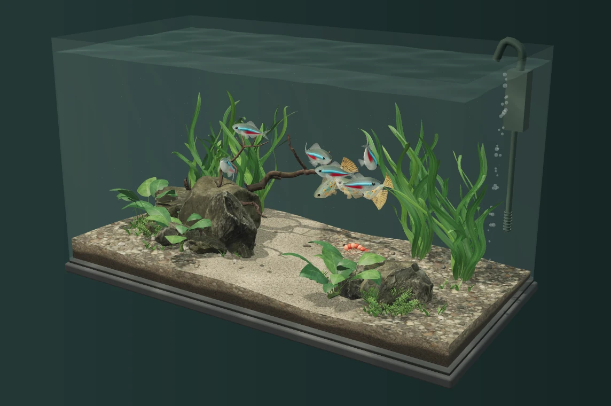
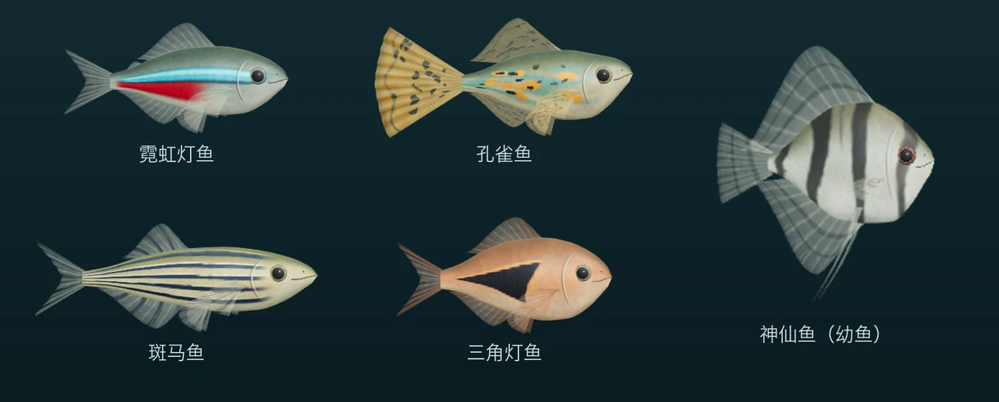
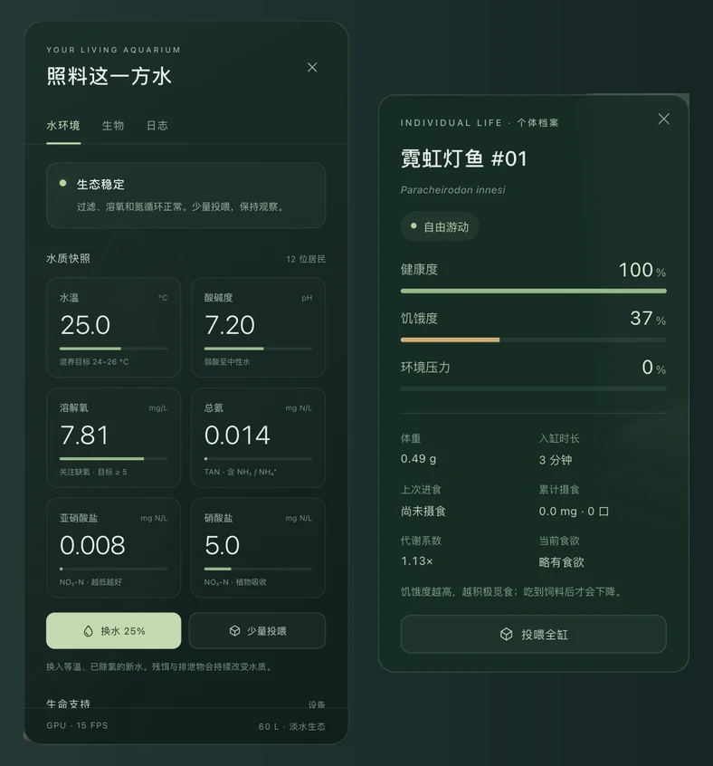

# 澄境 · Cyber Aquarium

一只放在桌面上的 60 L 淡水鱼缸。鱼群在沉木和水草间游动，饥饿的鱼会追逐刚投下的饲料。玻璃、缸底的石墨灰底托和水面一起由 Three.js 实时渲染，缸外透明处可以直接点击其他应用。



## 下载桌面版

登录 GitHub，打开最近一次成功的构建。在运行详情底部的 **Artifacts** 中，下载适合自己电脑的压缩包。[Windows 和 macOS 构建记录](https://github.com/xingxingRealzyx/cyber-aquarium/actions/workflows/desktop.yml)

| 平台 | 下载 | 启动 |
| --- | --- | --- |
| Windows x64 | `Cyber-Aquarium-windows-x64.zip` | 将整个压缩包解压到同一文件夹，双击其中的 `Cyber Aquarium.exe`。 |
| macOS Apple Silicon | `Cyber-Aquarium-macos-arm64.zip` | 解压后将 `Cyber Aquarium.app` 拖入「应用程序」并打开。 |

两个平台都使用 GPU 渲染，需要支持 WebGL 2 的显卡和驱动。Windows 版通过 Chromium 的 ANGLE 调用显卡，通常使用 Direct3D 11。Windows 构建日志会列出 CI 虚拟机实际使用的适配器与后端，玩家电脑会按本机驱动选择。macOS 构建使用本地临时签名，首次打开时系统可能提示验证开发者。

## 先试这几个操作

| 想做什么 | 怎么操作 |
| --- | --- |
| 换个角度看鱼缸 | 在缸体上按住鼠标左键拖动。 |
| 看清鱼鳞或叶脉 | 指向想看的位置，滚动滚轮或用触控板双指缩放。放大至铺满工作区后还能继续看局部，双击缸体恢复全景。 |
| 把鱼缸挪到桌角 | 鼠标移到缸体上，按住底部工具栏的「移动」拖到新位置。 |
| 看一条鱼有没有吃饱 | 点鱼打开个体档案，再点「投喂」。观察它追食后的饥饿度、上次进食时间和累计摄食量。 |
| 加鱼或种草 | 点「生物」，从品种预览中选择鱼、虾、螺或水草。 |
| 临时收起或恢复操作 | 点击菜单栏（macOS）或系统托盘（Windows）的鱼形图标。开启鼠标穿透后，可从这里选择「显示鱼缸 / 恢复操作」。 |

## 水下居民

可饲养五种鱼，还可加入樱花虾和斑马螺。苦草的长叶会随水流摆动，小水榕和爪哇莫丝分布在底床与石组周围。每只动物都有自己的编号、健康、饥饿和进食记录。



## 从一粒饲料看水质

点「投喂」后，饲料颗粒从水面下沉。饥饿的鱼更积极地追食，碰到颗粒才会吃下去。剩下的饲料沉入底床，虾、螺可以在那里觅食。长期积累的残饵会消耗溶氧、增加氨负荷，水看起来清澈时也值得查看读数。



「水质」面板可以换水 25%，也能调节过滤、增氧、加热与照明。过滤系统把氨逐步转为亚硝酸盐、硝酸盐，水草在光照下吸收养分并产氧。缺氧、有毒含氮物质累积或长期饥饿会损伤健康，严重时会导致死亡。这套简化模型的参数和适用范围见[淡水生态模拟说明](docs/SIMULATION.md)。

默认现实 1 秒相当于缸内 1 分钟。设置里可以切换实时、60 倍、3600 倍或暂停。鱼缸自动保存在本机，重新打开会从上次进度继续，退出期间暂停生态演化。

## 从源码运行

安装 Node.js 24，在项目目录运行以下命令。启动的是带透明桌面层的 Electron 应用。

```sh
npm ci
npm start
```

只调试渲染页面时，可以运行 `npm run dev` 在浏览器预览。其他常用命令如下。

| 命令 | 用途 |
| --- | --- |
| `npm test` | 检查生态模拟、个体行为、摄食和存档恢复。 |
| `npm run build` | 使用 Vite 构建渲染页面。 |
| `npm run package:win` | 在 Windows x64 上打包便携版。 |
| `npm run package:mac` | 在 Apple Silicon Mac 上打包桌面应用。 |

本地桌面包写入 `release/`。GitHub Actions 在推送到 `main` 和提交拉取请求时运行测试与双平台构建，也可以从 Actions 页面手动触发。[构建工作流](.github/workflows/desktop.yml)
