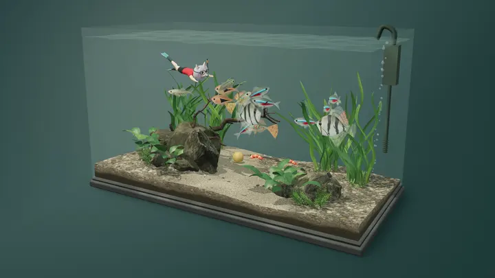
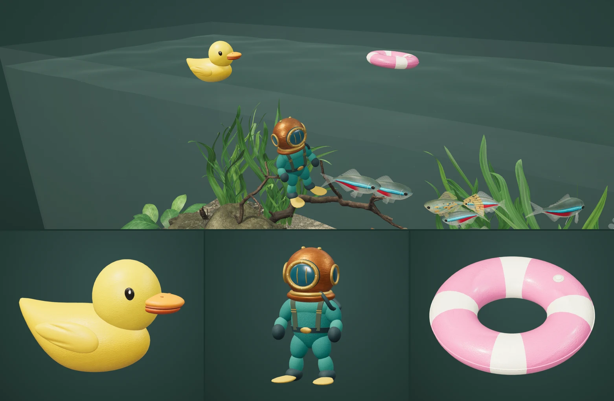
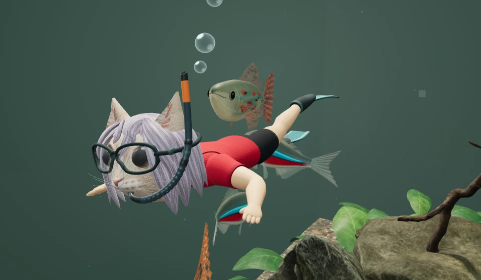

# 澄境 · Cyber Aquarium

一只放在桌面上的 60 L 淡水鱼缸。鱼群在沉木和水草间游动，饥饿的鱼会追逐刚投下的饲料。玻璃、缸底的石墨灰底托和水面一起由 Three.js 实时渲染，缸外透明处可以直接点击其他应用。

[](https://github.com/xingxingRealzyx/cyber-aquarium/releases/download/v0.10.0/aquarium-orbit.mp4)

**那位穿红短袖、戴潜水面罩的银发猫猫头，就是作者本人的形象。** 写着写着，我把自己也养进鱼缸了 😂

[下载完整环绕视频（27 秒 · 1080p MP4）](https://github.com/xingxingRealzyx/cyber-aquarium/releases/download/v0.10.0/aquarium-orbit.mp4) · [查看静态全景](docs/images/aquarium.webp)

## 下载桌面版

打开最新正式版，下载适合自己电脑的压缩包。[GitHub Releases](https://github.com/xingxingRealzyx/cyber-aquarium/releases/latest)

| 平台 | 下载 | 启动 |
| --- | --- | --- |
| Windows x64 | `Cyber-Aquarium-windows-x64.zip` | 将整个压缩包解压到同一文件夹，双击其中的 `Cyber Aquarium.exe`。 |
| macOS Apple Silicon | `Cyber-Aquarium-macos-arm64.zip` | 解压后将 `Cyber Aquarium.app` 拖入「应用程序」并打开。 |

点底部右侧的滑杆图标打开「设置」，可在「软件更新」中手动检查版本。支持自动提醒的桌面版会在启动时检查，之后每 6 小时再查一次。有适用于本机的新正式版时，滑杆图标右上角会出现黄点。点开就能看到版本号，再点「下载并重启更新」即可升级并沿用本机鱼缸存档。应用内更新从 v0.6.0 起可用，v0.5.2 及更早版本首次升级需从上面的发布页下载。

直接更新需要安装目录可写。在 Mac 上可使用个人目录下的「应用程序」，在 Windows 上可将便携版完整解压到自己的文件夹。如果更新途中断电，重新开机后可双击应用旁的 `Recover Cyber Aquarium.command`（Mac）或 `Recover Cyber Aquarium.cmd`（Windows）恢复原版。

两个平台都使用 GPU 渲染，需要支持 WebGL 2 的显卡和驱动。Windows 版通过 Chromium 的 ANGLE 调用显卡，通常使用 Direct3D 11。在「水质」面板底部，将鼠标悬停在 **WebGL 2 · FPS** 上，可以查看当前鱼缸所用的图形适配器。Windows 构建日志也会记录 CI 机器实际使用的适配器与后端。macOS 构建使用本地临时签名，首次打开时系统可能提示验证开发者。

## 先试这几个操作

| 想做什么 | 怎么操作 |
| --- | --- |
| 换个角度看鱼缸 | 在缸体上按住鼠标左键拖动。 |
| 看清鱼鳞或叶脉 | 指向想看的位置，滚动滚轮或用触控板双指缩放。放大至铺满工作区后还能继续看局部，双击缸体恢复全景。 |
| 把鱼缸挪到桌角 | 鼠标移到缸体上，按住底部工具栏的「移动」拖到新位置。 |
| 看一条鱼有没有吃饱 | 点鱼打开个体档案，再点「投喂全缸」。观察它追食后的饥饿度、上次进食时间和累计摄食量。 |
| 看公母和体型 | 点鱼、虾或螺打开个体档案，查看性别、生命阶段、相对成年体长和体重。很小的幼体也可从「生物」列表点选。 |
| 给居民找个伴 | 在「生物」里选「公」或「母」，再点对应物种卡片。同种健康的公母成年后有机会配对。「繁殖进度」会显示孕育方式和预计出生或孵化的缸内时间。 |
| 照顾生病的鱼 | 「生物」出现黄点时，打开列表，点排在最前的患病个体。档案显示感染类型和病情，点「开始护理」后可观察它恢复。 |
| 捞起死鱼 | 点水中的遗体，在档案底部选「捞起遗体」。也可打开「生物」一次捞起全部遗体。 |
| 移出一条鱼 | 点选那条鱼，在个体档案最下方点「移出鱼缸」。操作会立即保存，日志里可以查到移出的个体编号。 |
| 加鱼、虾或螺 | 点「生物」，从品种预览中选择。 |
| 增减水草和造景 | 点「生物」→「造景」，在苦草、小水榕、爪哇莫丝、溪石或沉木旁点 ＋ 或 −。减号移出最后加入的一件，也可以展开品种，按编号移出指定的一件。 |
| 放漂浮玩具 | 在「造景」里点玩具旁的 ＋。小黄鸭和小游泳圈贴着水面起伏，潜水员在水中上下漂移。每个游泳圈放入时随机选取六种配色之一，重开后保留。点 − 可收回，也可展开列表按颜色和编号移出。 |
| 让作者下水 | 打开「造景 → 恶搞造景」，点「作者本人」旁的 ＋。这位银发猫头的男潜水员穿红短袖、黑泳裤和长脚蹼，边划水边交替踢蹼。留意嘴角的气泡和头侧的橙色管口，上浮换气时只有管口需要露出水面。点 − 即可收回。 |
| 临时收起或恢复操作 | 点击菜单栏（macOS）或系统托盘（Windows）的鱼形图标。开启鼠标穿透后，可从这里选择「显示鱼缸 / 恢复操作」。 |
| 退出桌面鱼缸 | 右键缸体，或点底部右侧的设置滑杆，再点面板右下角的「退出鱼缸」。应用会保存进度并退出。如果开了鼠标穿透，重新打开应用即可恢复操作。 |

拉近看，游泳圈外沿有一圈压合缝，充气阀位于彩色面上。小黄鸭的软胶表面带有细粒和羽翼压纹，潜水服的织纹、头盔的铜面和玻璃舷窗各有不同的反光。





## 水下居民

从 v0.11.0 起可饲养 15 种淡水鱼，还有樱花虾和斑马螺。在「生物」面板能看到每种鱼在缸里的实际模型。七彩神仙鱼有圆盘状的侧身和红底青纹，红鼻剪刀鱼有红色吻部和黑白相间的尾鳍，波氏彩虹鱼的前后半身分别呈蓝色和橙色。苦草的长叶会随水流摆动，小水榕和爪哇莫丝分布在底床与石组周围。

每只动物都有自己的编号、健康、饥饿和进食记录。新放入的鱼从幼年开始，摄食和健康状况影响长大的速度。15 种鱼的参考寿命为 4～10 个模拟日。默认 60× 下，新入缸的孔雀鱼约 10～14 分钟成年，照料得当时约 73～106 分钟走完一生。神仙鱼寿命较长，约为 3～4.5 小时。

新缸的第一次随机感染出现在第 5～10 个模拟小时，默认速度下约为现实 5～10 分钟。得了病毒或细菌感染的鱼会游慢，档案中的病情会随时间变化。水质良好、吃得够的鱼有机会自行恢复，持续恶化则可能死亡。虾和螺不参与感染事件。

月光鱼和孔雀鱼直接产下小鱼，宝莲灯鱼和红鼻剪刀鱼会散卵，三角灯鱼在叶面附卵，樱桃鲃和波氏彩虹鱼把卵黏在水草上。神仙鱼和七彩神仙鱼由双亲守卵。在七彩专缸中，可以把「水质」里的目标水温调到 27 °C，等一公一母都成年。混养时，水质面板会显示全缸居民共同适应的温度范围。樱花虾在腹部抱卵，斑马螺把卵囊附在缸壁，游戏允许少量小螺在淡水缸里孵出。每只后代都有自己的编号和双亲记录，出生后，体长、体重和水里的模型会随成长逐步增大。暂停或关闭应用会同时暂停孕育与成长。

想最快看到第一窝，可以观察新缸自带的一对成年樱花虾。保持默认 60×、水质和摄食正常，通常开缸约 2 分钟能看到母虾抱卵，再过约 9 分钟可看到小虾。点小虾的档案能一路看到它从约三分之一成年体长慢慢长大。


## 从一粒饲料看水质

点「投喂」后，饲料颗粒从水面下沉。饥饿的鱼更积极地追食，碰到颗粒才会吃下去。剩下的饲料沉入底床，虾、螺可以在那里觅食。长期积累的残饵会消耗溶氧、增加氨负荷，水看起来清澈时也值得查看读数。


「水质」面板可以换水 25%，也能调节过滤、增氧、加热与照明。过滤系统把氨逐步转为亚硝酸盐、硝酸盐，水草在光照下吸收养分并产氧。缺氧、有毒含氮物质累积或长期饥饿会损伤健康，严重时会导致死亡。死鱼会逐渐翻侧、上浮并褪色，直至手动捞起。遗体腐败会释放氨、消耗溶氧；捞起后，水中已有的污染仍需靠过滤或换水处理。这套简化模型的参数和适用范围见[淡水生态模拟说明](docs/SIMULATION.md)。

默认现实 1 秒相当于缸内 1 分钟。设置里可以切换实时、60 倍、3600 倍或暂停。鱼缸自动保存在本机，重新打开会从上次进度继续，退出期间暂停生态演化。

## 从源码运行

安装 Node.js 24，在项目目录运行以下命令。启动的是带透明桌面层的 Electron 应用。

```sh
npm ci
npm start
```

只调试渲染页面时，可以运行 `npm run dev` 在浏览器预览。其他常用命令如下。

| 命令 | 用途 |
| --- | --- |
| `npm test` | 检查生态模拟、个体行为、摄食和存档恢复。 |
| `npm run build` | 使用 Vite 构建渲染页面。 |
| `npm run package:win` | 在 Windows x64 上打包便携版。 |
| `npm run package:mac` | 在 Apple Silicon Mac 上打包桌面应用。 |

本地桌面包写入 `release/`。GitHub Actions 在推送到 `main` 和提交拉取请求时运行测试与双平台构建，也可以从 Actions 页面手动触发。[构建工作流](.github/workflows/desktop.yml)
